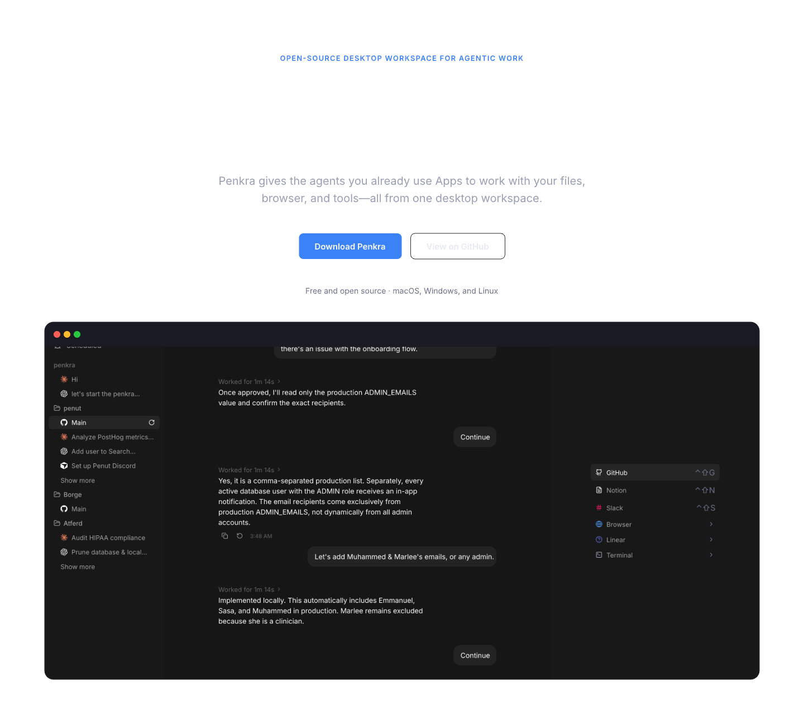
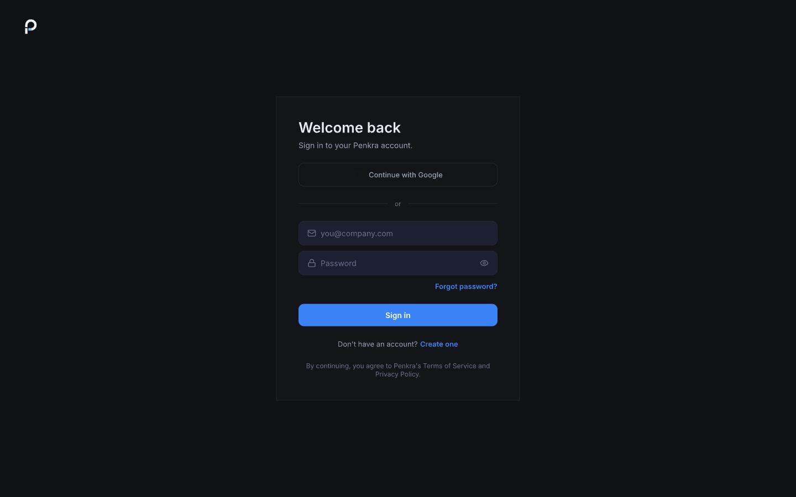

# Penkra Website

**The public face of Penkra — [penkra.com](https://penkra.com)**



The Penkra website is where people learn about Penkra, create and manage their accounts, and get back into the desktop app. It handles authentication, account verification, recovery, and serves as the launch point for the Penkra experience.

## What the website does

The website handles the account-side of Penkra:

- **Sign up and sign in** — create an account or log in to connect your desktop app
- **Account verification** — verify your email and activate your account
- **Account recovery** — reset your password if you lose access
- **Landing page** — learn about Penkra and what it can do

Authentication is powered by Better Auth with Google OAuth. The browser client talks directly to the Penkra API (`api.penkra.com`) — the website does not proxy auth routes.



## For developers

### Tech stack

| Layer | Technology |
|-------|-----------|
| Framework | Next.js 16 |
| React | 19 |
| Auth | Better Auth (with Electron adapter) |
| Testing | Vitest, Storybook |
| Package manager | pnpm 11.7.0 |
| Node | 22 |

### Getting started

```sh
pnpm install
pnpm dev
```

The local Next.js server runs on `http://localhost:3000` by default. Auth requests go to `http://localhost:3012/auth`. Override `NEXT_PUBLIC_PENKRA_AUTH_URL` if your local backend uses a different origin.

### Other commands

```sh
pnpm typecheck    # Type checking
pnpm build        # Production build
pnpm start        # Start the production server
```

### Design system

The website's visual design is authored in Pencil (`penkra-website.pen`). That file is the canonical source for screens, components, interaction states, and responsive behavior.

### Deployment

The production site is deployed with Docker Compose on a Hetzner proxy:

- Joins the external Docker network `nginx-proxy`
- Uses `VIRTUAL_HOST`, `VIRTUAL_PORT`, and `LETSENCRYPT_HOST` environment variables
- Production host: `penkra.com`
- GitHub Actions deploys with the repo runner labeled `self-hosted`, `Linux`, `ARM64`, `penkra`, and `website`
- Production deployment requires an explicit workflow dispatch so coordinated backend and website changes roll out together

The production URL is **[https://penkra.com](https://penkra.com)**.

### Smoke checks

The deploy workflow verifies these routes locally before shipping:

| Route | What it checks |
|-------|---------------|
| `/` | Landing page loads |
| `/sitemap.xml` | Sitemap contains `penkra.com` |
| `/robots.txt` | Robots file references the sitemap |
| `/manifest.webmanifest` | PWA manifest is present and correct |

A scheduled **Smoke** workflow also runs every 6 hours against the live site and can be dispatched manually after DNS or deployment changes.
